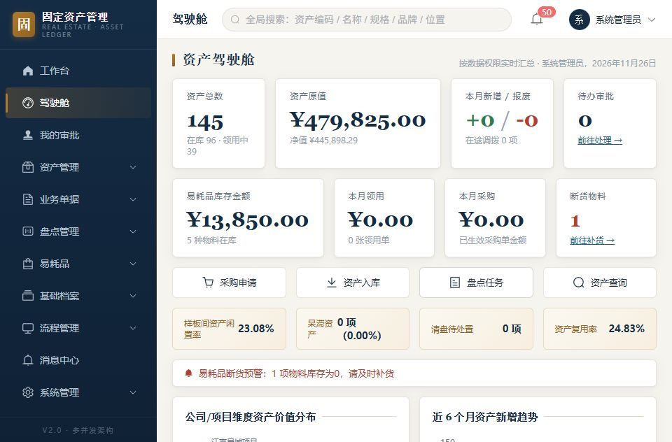
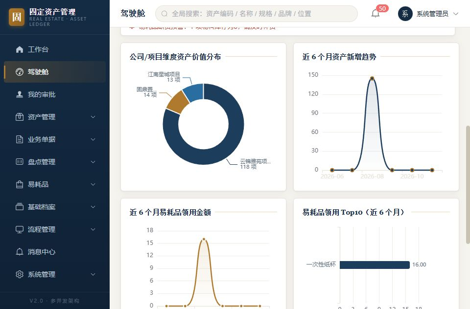
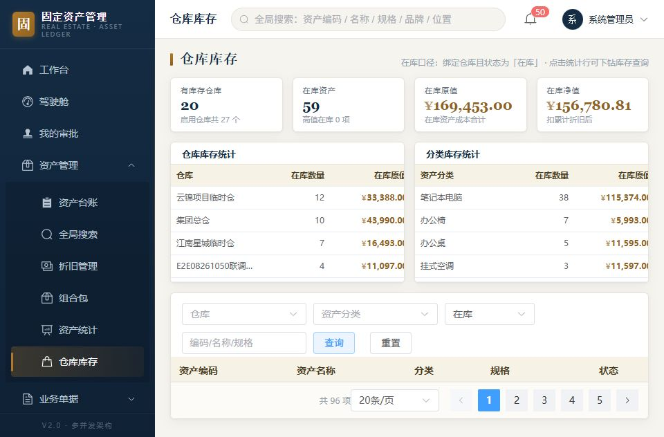
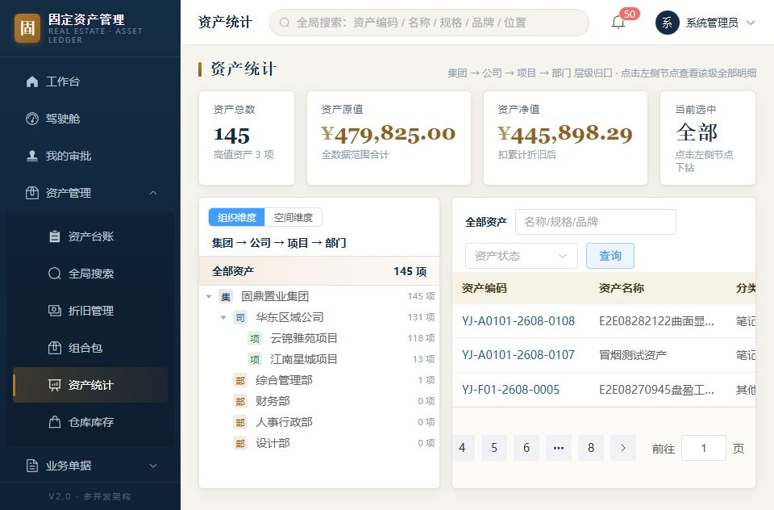
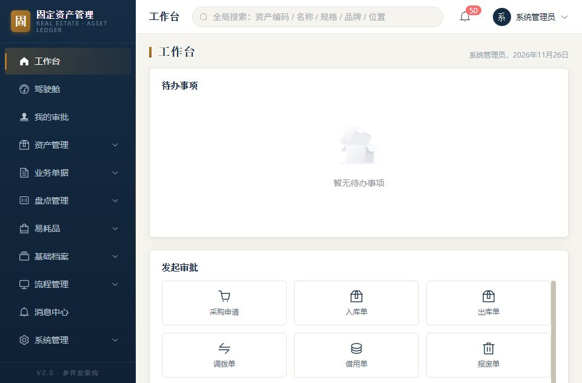
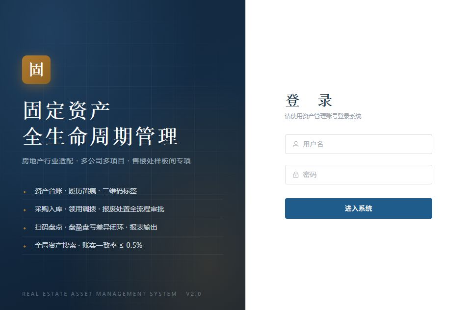

# 固鼎 · 固定资产管理系统

面向企业（尤其多组织 / 多项目场景）的全栈固定资产管理系统，覆盖资产从**采购 → 入库 → 领用 → 调拨 → 借用 → 归还 → 折旧 → 盘点 → 报废处置**的全生命周期，内置可配置审批流、移动端扫码盘点与数据驾驶舱。

> 前后端分离：FastAPI（异步）+ Vue 3 + MySQL 8。开箱即用，内置演示数据，可作为二次开发底座。

## 📸 界面预览

| 驾驶舱 · 核心指标 | 驾驶舱 · 价值分布与新增趋势 |
|:---:|:---:|
|  |  |

| 仓库库存 | 资产统计（组织 / 空间维度下钻） |
|:---:|:---:|
|  |  |

| 工作台（待办与快捷发起） | 登录 |
|:---:|:---:|
|  |  |

## ✨ 功能特性

- **资产全生命周期**：资产台账、组合包、仓库库存、折旧管理、资产统计
- **单据与流程**：采购申请、入库、出库、调拨、借用、归还、报废处置，配套**可配置审批流**（流程配置 + 流程监控 + 我的审批）
- **耗材 / 易耗品**：物料档案、采购、易耗入库、领用、库存查询
- **盘点**：盘点任务、移动端 H5 扫码盘点（`/m/stocktake`）
- **移动审批**：移动端 H5 审批（`/m/approval`）
- **数据看板**：驾驶舱、工作台、全局搜索、消息中心
- **基础档案**：资产分类、供应商、仓库、项目空间、办公地点
- **系统管理**：组织架构、用户、角色、菜单、数据字典、操作日志（RBAC，按钮级 + 数据级权限）
- **导入导出**：基于 Excel 的批量导入 / 导出

## 🧱 技术栈

| 层 | 技术 |
|----|------|
| 后端 | Python 3.12+、FastAPI、SQLAlchemy 2 (async)、PyJWT、bcrypt、uv |
| 前端 | Vue 3、Vite、Element Plus、Pinia、Vue Router、ECharts |
| 数据库 | MySQL 8（utf8mb4） |
| 部署 | Docker / Docker Compose、Nginx |

## 🚀 快速开始（Docker，推荐）

```bash
# 1. 克隆
git clone <仓库地址> guding
cd guding

# 2. 配置环境变量（生产环境务必改密码与 JWT 密钥）
cp .env.example .env        # 修改 DB_PASSWORD、JWT_SECRET

# 3. 启动 MySQL + 后端 + 前端
docker-compose up -d

# 4. 初始化数据库与演示数据（首次）
docker-compose exec backend python init_db.py
```

访问：

| 服务 | 地址 |
|------|------|
| 前端 | http://localhost:5201 |
| 后端 API 文档 | http://localhost:5200/docs |
| 默认账号 | `admin` / `admin123`（首次登录后请立即修改） |

## 🛠 手动部署（开发模式）

```bash
# 后端
cd backend
cp .env.example .env          # 配置数据库等
pip install uv && uv sync
uv run python init_db.py      # 建表 + 种子数据
uv run uvicorn app.main:app --reload --port 5200

# 前端（另开终端）
cd frontend
npm install
npm run dev                   # 默认 http://localhost:5173，代理到后端 5200
```

> 数据库需先准备一个可访问的 MySQL 8 实例，并在 `backend/.env` 中配置 `DB_HOST/DB_PORT/DB_USER/DB_PASSWORD/DB_NAME`。

## 📁 目录结构

```
guding/
├── backend/            # FastAPI 后端
│   ├── app/
│   │   ├── api/        # 接口路由
│   │   ├── core/       # 配置、安全、依赖
│   │   ├── db/         # 数据库会话与基类
│   │   ├── models/     # ORM 模型
│   │   └── ...
│   ├── init_db.py      # 建表 + 种子数据
│   ├── .env.example    # 环境变量模板
│   └── Dockerfile
├── frontend/           # Vue 3 前端
│   ├── src/
│   │   ├── views/      # 页面（asset/doc/con/check/archive/system/mobile…）
│   │   ├── router/     # 路由与权限守卫
│   │   └── stores/     # Pinia 状态
│   └── Dockerfile
├── docker-compose.yml  # 一键编排（MySQL + 后端 + 前端）
├── .env.example        # docker-compose 变量模板
└── DEPLOY.md           # 外网部署 / Nginx / HTTPS 详细指南
```

## 🔐 安全须知

- **切勿**将 `backend/.env`、根 `.env`、`frontend/certs/`（TLS 证书与私钥）提交到仓库，已通过 `.gitignore` 排除。
- 上线前务必修改默认密码、`JWT_SECRET`，并将 CORS 收敛为实际前端域名（见 `backend/app/core/config.py`）。
- 生产环境建议配置 HTTPS 与反向代理，详见 [DEPLOY.md](DEPLOY.md)。

## 📄 License

本项目基于 **GNU Affero General Public License v3.0**（[AGPL-3.0](LICENSE)）开源，完整条款见 [LICENSE](LICENSE)。

需要注意 AGPL-3.0 的强传染性义务：

- 你可以自由使用、修改和分发本软件，**包括商用**，但必须以 AGPL-3.0 开源你的修改与衍生作品。
- 修改版**通过网络对外提供服务**（SaaS、网站后台等）同样视为分发，必须向使用者公开对应完整源代码。
- 保留「固鼎」名称、Logo 及相关商标的所有权利。

如需将本项目用于**闭源产品或不愿开源内部修改**的商业场景，请通过邮箱 <zhjpanx@126.com> 获取单独的商业授权（双许可模式）。
